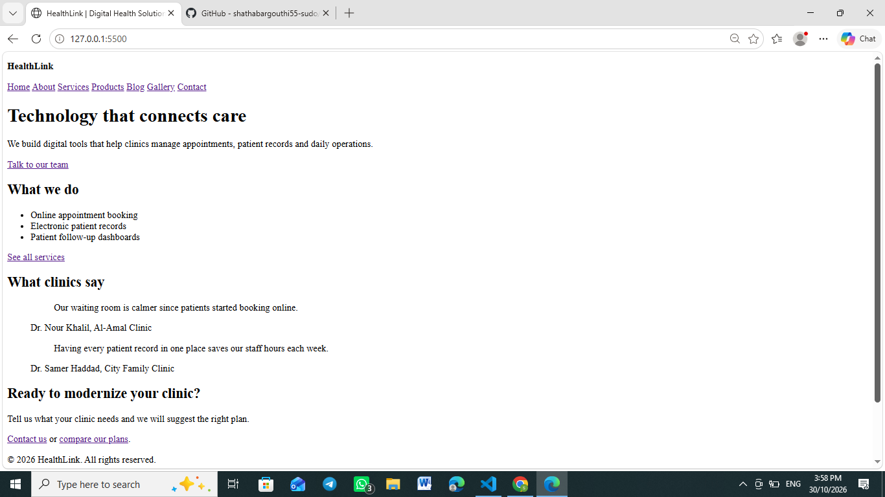
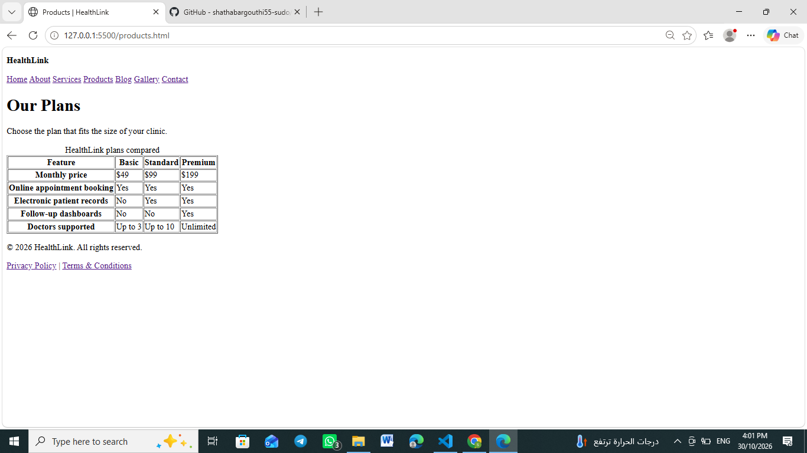
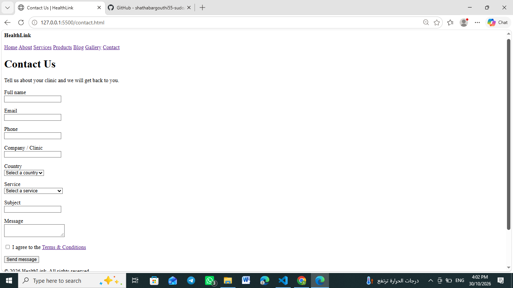

# HealthLink Corporate Website

A multi-page corporate website for HealthLink, a fictional digital health company. Built with semantic HTML5 as part of the Grids Apps Full Stack Web Development Internship (Document 01).

## Pages

- Home
- About
- Services
- Service Detail
- Products (plans comparison table)
- Blog
- Blog Detail
- Gallery
- Contact (form with native validation)
- Privacy Policy
- Terms & Conditions

## Features

- Semantic structure: header, nav, main, section, article, aside, footer
- One h1 per page and a logical heading hierarchy
- Unique title and meta description on every page
- Consistent navigation with the current page marked
- Lists, figures with captions, and an accessible comparison table
- Contact form with labels, grouped options and native validation
- Descriptive alt text on all images

## Technologies

- HTML5

## How to Run

1. Clone the repository.
2. Open the project folder in VS Code.
3. Right-click `index.html` and choose "Open with Live Server", or open `index.html` directly in a browser.

## Folder Structure

    gridsapps-html-corporate-site/
    ├── index.html
    ├── about.html
    ├── services.html
    ├── service-detail.html
    ├── products.html
    ├── blog.html
    ├── blog-detail.html
    ├── gallery.html
    ├── contact.html
    ├── privacy.html
    ├── terms.html
    ├── assets/
    │   ├── images/
    │   ├── icons/
    │   ├── css/
    │   └── js/
    └── labs/
        └── doc-01-html/
            └── h01-profile.html

## Screenshots

## Author

Shatha Abdelmajeed